# Neural Size

How big does a feed-forward network need to be, and does it matter where its weights are put?

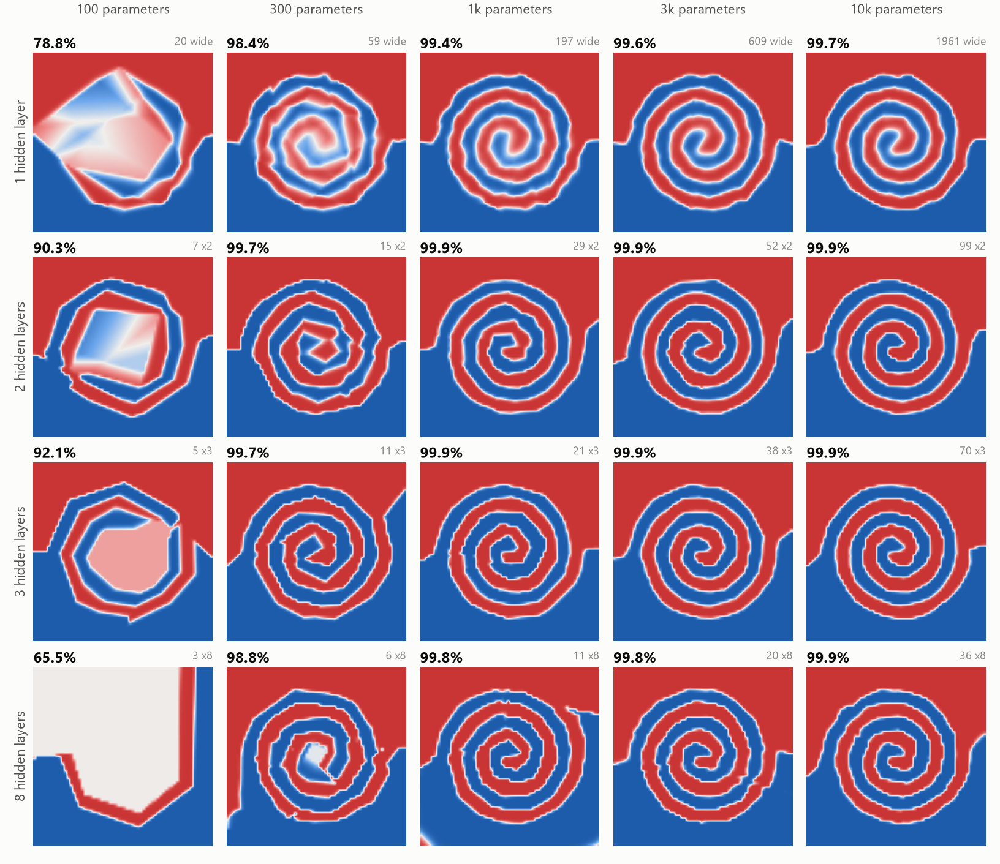

*One task, twenty networks. The task: which of two spiral arms is a point on? Each picture is one trained network's answer for every point in the square (red for one arm, blue for the other), with that run's test accuracy above it. Left to right the networks get more parameters; top to bottom they get more hidden layers. With one hidden layer it takes about 1,000 parameters to draw the spiral properly. With three, 300 is enough.*

A feed-forward network is the plainest kind of neural network: numbers go in, pass through a few layers of units, and an answer comes out. Its size comes down to two choices, how many hidden layers and how wide each one is. This project trains 698 networks that differ only in those choices, on six tasks that differ in how many inputs they have (2, 96 or 1,000) and how complicated the rule is, and measures what each shape can learn and what it costs.

**What came out of 3,965 training runs:**

- **The size a task needs is set by the task, not by the number of inputs.** The smallest network that got within a point of the best: 32 parameters for the circle, 321 for the spirals, 29,863 for the small digits. The three tasks with 1,000 inputs needed 3,019 parameters, 10,472 and more than 293,055.
- **Past that size, more weights buy almost nothing.** On the spirals, going from 321 parameters to 102,827 (320 times as many) raised accuracy from 99.8% to 99.9%.
- **Deeper or wider depends on the task.** On the spirals three layers needed a third of the parameters one layer did, and seen through 1,000 sensors one hidden layer never learned them at all (61% with 305,000 parameters, against 99.5% for five thin layers with 10,000). But on the small digits a single wide layer was the best shape at every size from 1,000 parameters up, and twelve layers the worst.
- **A harder version of the same task needs a bigger network, and the growth is steep.** Spirals with half a turn needed 24 parameters; with five turns, 10,292.
- **With 1,000 inputs the first hidden layer holds nearly all the weights, and whether that is money well spent depends on what the inputs contain.** In a network of three 64-unit layers, 88% of the weights feed the first one. On the big digits every one of them earned its keep: accuracy rose from 60% with a first layer of 4 units to 97.5% with 512. On the sensors, 16 units gave 99.7% and 512 gave 99.3% for 26 times the parameters. On the needles the best first layer had 2 units and every wider one was worse.
- **The exact shape matters much less than avoiding a pinch.** Given enough parameters, five different three-layer shapes landed within about 2 points of each other on every task. What did real damage was any layer of 2 or 3 units: on the big digits a 10-5-2 network scored 46% where 10-10-10 scored 77%.
- **A bigger network did not overfit more, except where data was the limit.** On the digits the gap between training and test accuracy shrank as the network grew. On the needles every equal-width network from 10,000 parameters up memorised its training set and scored at least 7 points worse on new examples than a model with no hidden layer.
- **ReLU, Leaky ReLU and GELU were hard to tell apart** once a network was big enough for its task: within a point or two, with no consistent winner. GELU was ahead in very small networks. tanh was 2 to 4 points behind on the digits and the sensors at 100,000 parameters, and further behind in smaller networks.
- **ReLU networks sometimes die.** 31 of the 2,094 reported runs ended at chance level although the same network had learned the task on another seed. 29 of them were ReLU networks, none had fewer than three hidden layers, and 26 had a layer of 3 units or fewer.
- **Parameters are a poor guide to speed below about 10,000 of them.** A three-layer network with 87 parameters took 1.4 ms per training step and one with 10,292 took 1.7 ms. And one enormous layer costs far more than its parameter count suggests: 20,347 units in one layer trained 4 times slower and ran 11 times slower than three layers of 225 with the same number of parameters.

Everything is written from scratch in PyTorch and NumPy and runs on a CPU. The whole experiment took 85 minutes on four cores.

Two sister projects look at neighbouring questions: [Neural Efficiency](https://github.com/Ewan1303/Neural-Efficiency) holds the network fixed and turns the task difficulty up, and [Neural Arena](https://github.com/Ewan1303/Neural-Arena) compares network styles and training methods on control tasks.

## Contents

- [The six tasks](#the-six-tasks)
- [How every network is trained](#how-every-network-is-trained)
- [Results](#results)
  - [How big does it need to be?](#how-big-does-it-need-to-be)
  - [Deep or wide?](#deep-or-wide)
  - [A harder task needs a bigger network](#a-harder-task-needs-a-bigger-network)
  - [The first hidden layer](#the-first-hidden-layer)
  - [Five shapes with the same number of weights](#five-shapes-with-the-same-number-of-weights)
  - [Does a bigger network overfit?](#does-a-bigger-network-overfit)
  - [Activation functions](#activation-functions)
  - [Networks that die](#networks-that-die)
  - [The learning rate](#the-learning-rate)
  - [What it costs](#what-it-costs)
- [What this does not show](#what-this-does-not-show)
- [Run it yourself](#run-it-yourself)
- [What is in the repository](#what-is-in-the-repository)

## The six tasks

All six are classification problems generated from scratch, so nothing has to be downloaded. They were chosen to differ in two ways: how many inputs there are, and how complicated the rule is.

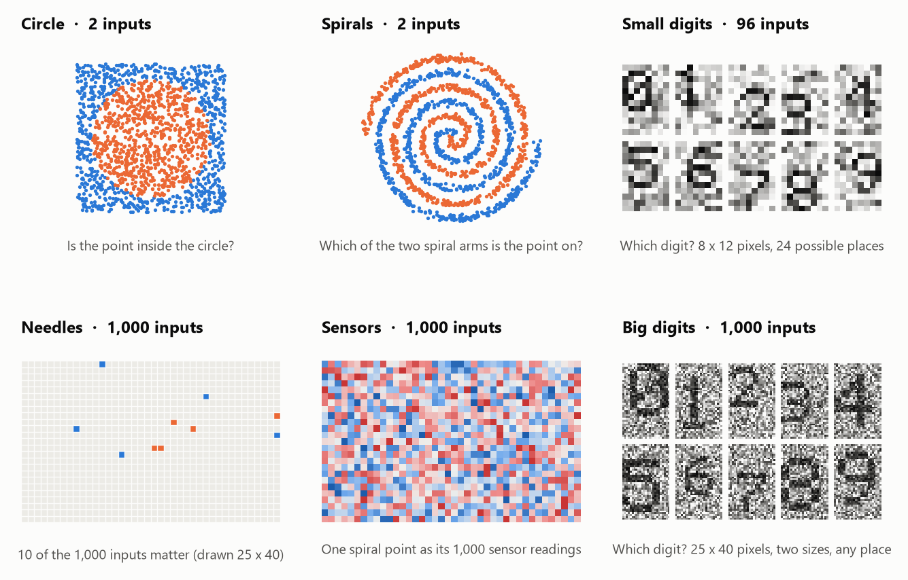

| Task | Inputs | Classes | The question | Training examples |
|---|---|---|---|---|
| **Circle** | 2 | 2 | Is the point inside a circle that covers half the square? | 2,000 |
| **Spirals** | 2 | 2 | Which of two interleaved spiral arms, three turns each, is the point on? | 4,000 |
| **Small digits** | 96 | 10 | Which digit is in this noisy 8×12 picture? It can sit in any of 24 places. | 10,000 |
| **Needles** | 1,000 | 4 | A thousand independent noisy inputs, of which only 10 matter. They form two hidden groups of 5, and the answer is the pair of signs of the two group sums. | 10,000 |
| **Sensors** | 1,000 | 2 | The spiral task again, but the point is reported by 1,000 sensors. Each sensor gives its own fixed mixture of the two coordinates plus a little noise. | 10,000 |
| **Big digits** | 1,000 | 10 | Which digit is in this noisy 25×40 picture? Two sizes, 298 possible placements. | 20,000 |

The three tasks with 1,000 inputs are a deliberate set, because "1,000 inputs" can mean three different things:

- **Needles:** almost all of the inputs are useless. The rule is simple once you know where to look; the difficulty is finding 10 inputs among 1,000 with only 10,000 examples.
- **Sensors:** every input is useful, but they all say the same two things. Underneath the 1,000 numbers there are only two.
- **Big digits:** every input is useful and they say different things. The digit can be anywhere, so no small set of pixels gives it away.

Circle and Spirals have the same two inputs and differ only in how complicated the rule is. Spirals and Sensors have the same rule and differ only in how many inputs it arrives through.

## How every network is trained

The point is to compare shapes, so everything else is held the same.

- **The network.** Plain fully-connected layers. Hidden units use ReLU unless a result says otherwise. Starting weights are drawn with He initialisation (standard deviation √2 ÷ √inputs-to-the-unit), which keeps the signal about the same size from layer to layer whatever the widths are.
- **The training.** Adam, batches of 128, cross-entropy loss. The learning rate warms up over the first 5% of the steps and then falls smoothly to zero. Every network on a task gets the same number of steps (2,000 to 6,000 depending on the task). No weight decay, no dropout, no early stopping, no batch normalisation.
- **The learning rate.** A network's best learning rate depends on its size, and comparing shapes at one fixed rate would partly be a comparison of how well that rate happens to suit each shape. So every network is first trained at three rates on seed 0 (0.003, 0.01 and 0.03 for networks under 30,000 parameters; 0.001, 0.003 and 0.01 for bigger ones). If the best of the three, judged on 2,000 validation examples, is the highest or the lowest, the next rate in that direction is tried as well, and so on until the best is no longer at an end (the range stops at 0.0003 and 0.1). Two more seeds are then trained at the rate that won.
- **The score.** Accuracy on 5,000 test examples that are used for nothing else. A seed changes the starting weights, which training examples are drawn and the order of the batches; the test examples are the same for every network. Each network's number is the middle one of its three seeds (the median), and the charts draw the lowest and highest as a thin vertical bar. The middle is used rather than the average because a run occasionally dies outright (see [Networks that die](#networks-that-die)), and one dead run in three would drag a good network's average down to a number no run actually scored.
- **Size.** "Parameters" means everything that is trained: weights plus biases. A network "with 10,000 parameters and 3 hidden layers" has three equal hidden layers whose width was chosen to land as close to 10,000 as whole numbers allow (within a few percent, except for the very smallest).

In a feed-forward network one forward pass costs one multiplication per weight, so the number of weights is also the amount of arithmetic. That is why the experiments compare shapes at an equal number of parameters: it is the same as comparing them at an equal amount of calculation.

## Results

Every number below is in [RESULTS.md](RESULTS.md), which has the full tables.

### How big does it need to be?

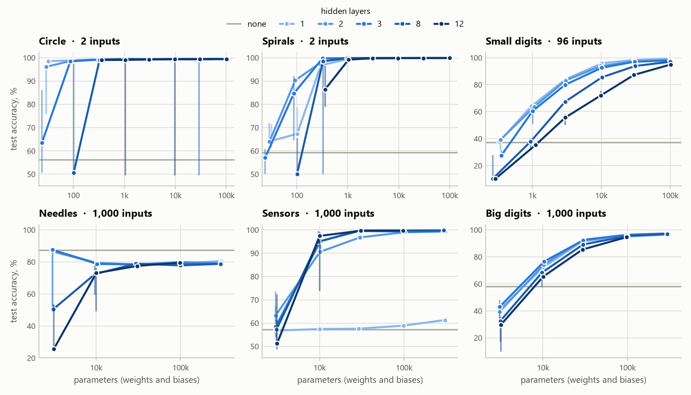

*Test accuracy against the number of parameters. Each line is one depth; the grey line is a model with no hidden layer at all. Vertical bars show the lowest and highest of the three seeds.*

Every task has a size below which networks fail and above which nothing much changes. Where that size sits is very different from task to task:

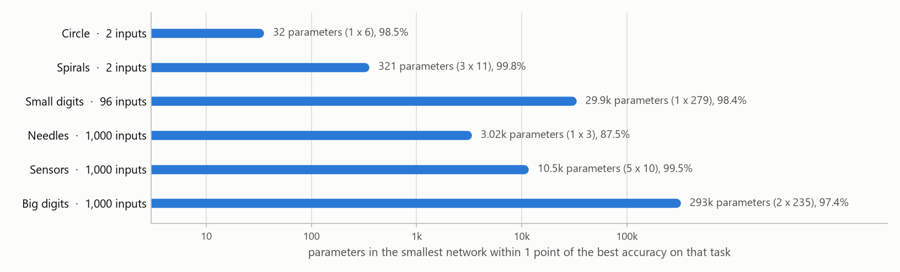

| Task | Inputs | No hidden layer | Best | Smallest network within 1 point of the best |
|---|---|---|---|---|
| Circle | 2 | 56.3% | 99.5% | 32 parameters: one layer of 6 units (98.5%) |
| Spirals | 2 | 59.2% | 99.9% | 321 parameters: three layers of 11 (99.8%) |
| Small digits | 96 | 37.2% | 99.2% | 29,863 parameters: one layer of 279 (98.4%) |
| Needles | 1,000 | 87.5% | 87.6% | 3,019 parameters: one layer of 3, the smallest tried (87.5%) |
| Sensors | 1,000 | 57.3% | 99.8% | 10,472 parameters: five layers of 10 (99.5%) |
| Big digits | 1,000 | 58.2% | 97.4% | 293,055 parameters: two layers of 235 (97.4%), and still rising |

(This table and the charts above cover networks whose hidden layers are all the same width. On the needles a network with a 2-unit first layer did better than any of them: see [The first hidden layer](#the-first-hidden-layer).)

Three things stand out.

**The number of inputs does not set the size.** The three tasks with 1,000 inputs sit at 3,000, 10,000 and 300,000 parameters. What the inputs contain matters, not how many there are. Sensors is the spiral task delivered through 1,000 inputs, and it needs about 30 times the parameters the two-input version does, nearly all of them just to connect the 1,000 inputs to a first layer of 10 units.

**Past the size a task needs, extra weights are wasted.** On the circle, 32 parameters score 98.5% and 102,827 score 99.5%. On the spirals 321 score 99.8% and 102,827 score 99.9%. The bigger networks cost more to train and to run (see [What it costs](#what-it-costs)) and give the same answers.

**The big digits never levelled off.** Accuracy was still climbing at the largest networks tried (97.4% with 293,000 parameters, 97.5% with 550,000), so the honest answer for that task is "bigger than anything here".

### Deep or wide?

The same number of parameters can be one wide layer or many thin ones. Which is better turned out to depend on the task.

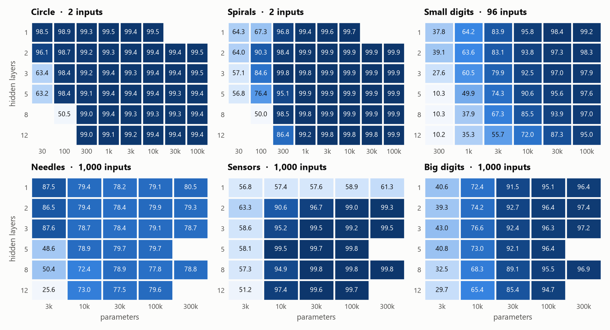

*Test accuracy (%) for each number of hidden layers (rows) at each parameter budget (columns). Blank cells were not run: either the layers would be narrower than 2 units, or wider than 4,096, or it is the costliest column at a depth that was skipped.*

**Spirals want depth.** A winding boundary is cheaper to build by bending space several times than by laying down hundreds of straight cuts in one go. Three layers of 11 units (321 parameters) reached 99.8%. One layer with the same budget (59 units) reached 96.8%, and one layer needed about 1,000 parameters to reach 99.4%. The picture at the top of the page shows the same thing: at 100 and 300 parameters the single-layer networks draw visibly rougher spirals.

**Sensors need depth.** With one hidden layer, no network learned the spiral through 1,000 sensors in the 4,000 training steps every network got: 61.3% was the best, with a layer of 304 units and 305,000 parameters. Its training accuracy was only 85%, so this is a failure to learn, not a failure to generalise. Five layers of 10 units reached 99.5% with 10,472 parameters. A plausible reading: a single layer has to pick the two real signals out of 1,000 readings and draw the spiral with the same units, while with more layers the first can do the picking and the rest the drawing.

**Digits want width.** On the small digits one hidden layer was the best shape at every budget from 1,000 parameters up, and accuracy fell with every layer added. At 100,000 parameters: 99.2% with one layer, 98.3% with two, 97.9% with three, 97.0% with eight, 95.0% with twelve. Recognising a digit that can be in 24 places is mostly a matter of having enough detectors, and at a fixed budget one wide layer has the most. On the big digits two or three layers were slightly ahead of one (97.4% and 97.2% against 96.4% at 300,000 parameters), and eight or twelve fell back again (95.5% and 94.7% at 100,000 parameters, against 96.4% for two).

**Deep and thin is the worst use of a small budget, everywhere.** At 3,000 parameters on the small digits, one layer of 28 units scored 83.9% and twelve layers of 12 units scored 55.7%. A thin layer is a bottleneck that every later layer has to live with, and thin ReLU layers are also the ones that die (below).

### A harder task needs a bigger network

The spiral task has a natural difficulty dial: the number of turns. Everything else is held fixed (three hidden layers, the same training).

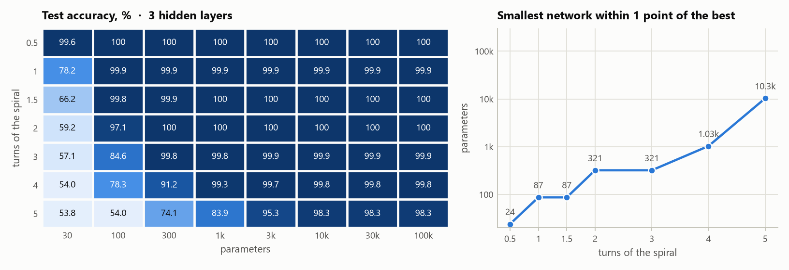

| Turns | 0.5 | 1 | 1.5 | 2 | 3 | 4 | 5 |
|---|---|---|---|---|---|---|---|
| Smallest network within 1 point of the best | 24 | 87 | 87 | 321 | 321 | 1,031 | 10,292 |

Ten times as many turns took about 400 times as many parameters. The steps in the table are coarse because the budgets go up by a factor of about three each time, but the direction is clear: the size needed grows much faster than the difficulty. (At five turns the best any network managed was 98.3%. The arms are so close together there that the noise on the points puts some of them on the wrong side.)

### The first hidden layer

Each unit in the first hidden layer has one weight per input. With 2 inputs that is nothing; with 1,000 inputs it is 1,000 weights per unit, and the first layer swallows the budget:

| Three equal hidden layers of | 16 units | 64 units | 256 units |
|---|---|---|---|
| 2 inputs: share of all weights that feed the first layer | 6% | 2% | 0.4% |
| 96 inputs | 70% | 41% | 16% |
| 1,000 inputs | 96% | 88% | 66% |

So with 1,000 inputs, the question "how wide should the first layer be?" is nearly the same question as "how big should the network be?". Two experiments look at it.

**One layer at a time.** Start from 64-64-64 and change only the first layer (blue), or only the two later layers (orange):

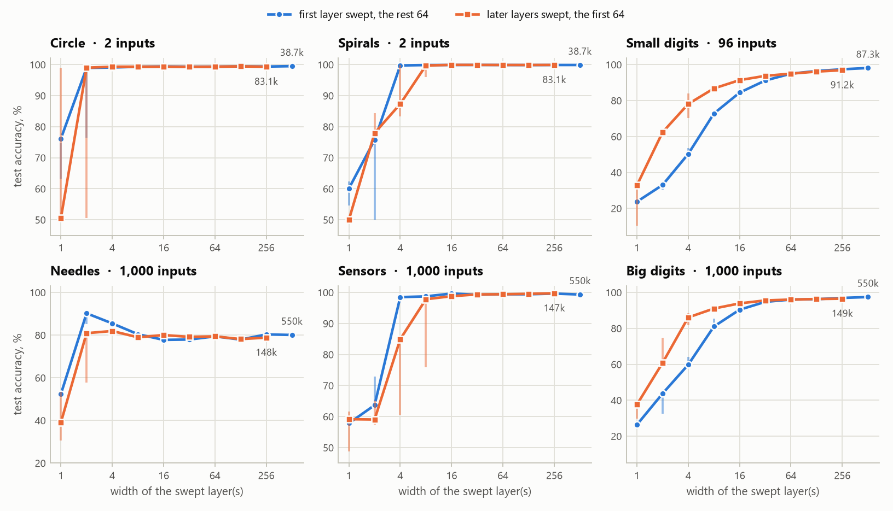

*The small numbers are the parameter counts of the widest network on each line. With 1,000 inputs, widening the first layer to 512 units costs 550,000 parameters; widening both later layers to 256 costs under 150,000.*

| First layer (the rest 64-64) | 1 | 2 | 4 | 8 | 16 | 64 | 512 |
|---|---|---|---|---|---|---|---|
| Parameters (big digits) | 5.9k | 7.0k | 9.1k | 13k | 22k | 73k | 550k |
| Needles | 52.4% | 90.2% | 85.5% | 80.4% | 77.8% | 79.4% | 80.1% |
| Sensors | 57.9% | 63.7% | 98.5% | 98.7% | 99.7% | 99.4% | 99.3% |
| Big digits | 26.4% | 43.7% | 59.8% | 81.1% | 90.4% | 96.0% | 97.5% |

The three tasks give three different answers.

- **Big digits: the first layer is what matters.** Accuracy climbs with every doubling and is still climbing at 512 units. Narrowing the first layer hurts more than narrowing the rest: with a first layer of 4 units and 64-unit layers after it the network scored 59.8%, while with a 64-unit first layer and 4-unit layers after it, it scored 86.1%. The digit can be anywhere on the canvas, so the network needs many different detectors looking at the raw pixels, and nothing later can make up for detectors that are not there.
- **Sensors: a first layer of 16 is as good as one of 512.** Four units already give 98.5%. The 1,000 readings only carry two numbers, and a handful of units is enough to recover them. A first layer of 512 units costs 26 times the parameters of one with 16 (549,634 against 21,394) and takes about four times as long per training step (6.8 ms against 1.7 ms) for the same accuracy. Here it is the later layers that need the width: with the first layer held at 64, later layers of 4 units scored 84.9% and of 32 units 99.4%.
- **Needles: the narrowest first layer that works is the best one.** Two units scored 90.2%, the best of any network on this task, and every wider first layer scored less. Only two combinations of the inputs matter (the two group sums), so two units are enough, and each extra unit brings another 1,000 weights, which is plausibly 1,000 more ways to fit noise in the 990 useless inputs.

Here is what the first-layer units end up looking at on the big digits. Each small picture is one unit's 1,000 incoming weights, laid out as the 25×40 image (red where ink raises the unit's output, blue where ink lowers it):

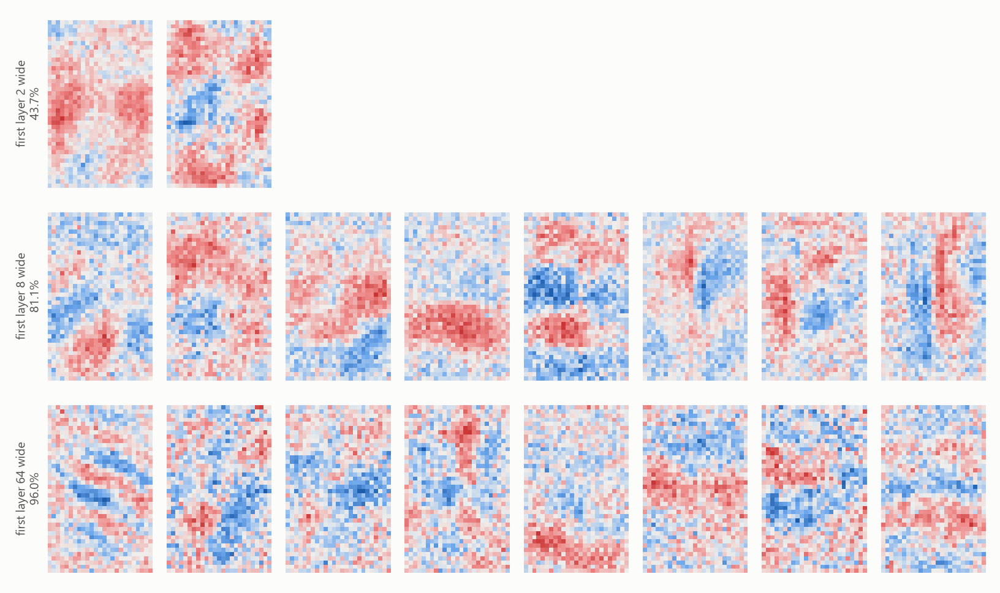

With 2 or 8 units, each one is a broad blob: all it can report is roughly where the ink is. That is not enough to tell a 3 from an 8. With 64 units there are enough of them for each to specialise in a smaller, sharper patch.

**A fixed budget, split differently.** The other way to ask the question: given a fixed number of parameters and three hidden layers, what share should go to the first layer? Each network here is first-w-w, with the first layer chosen and w taking whatever is left.

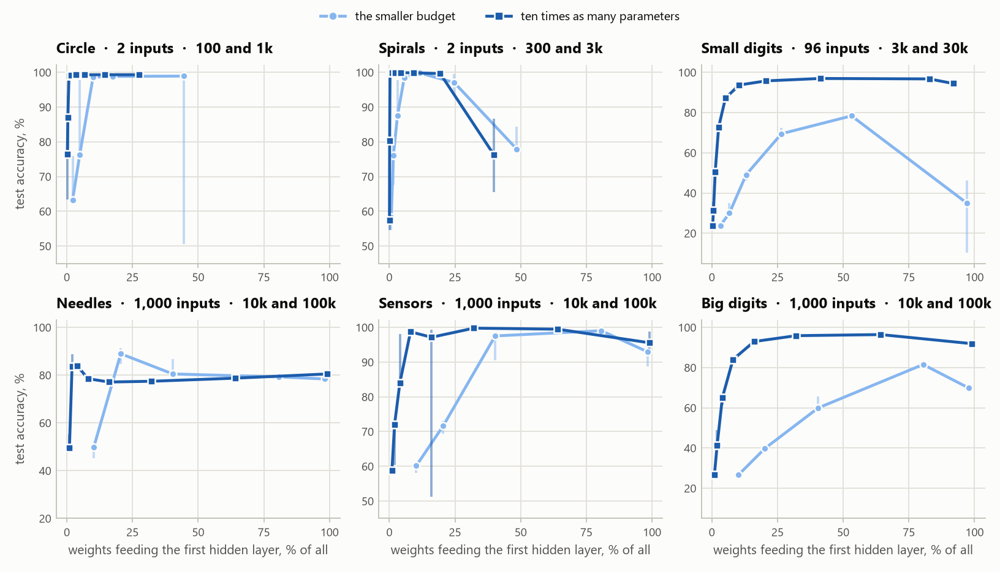

| About 100,000 parameters, 1,000 inputs | Share feeding the first layer | Needles | Sensors | Big digits |
|---|---|---|---|---|
| 2-306-306 | 2% | 83.8% | 72.1% | 41.2% |
| 4-302-302 | 4% | 83.9% | 84.0% | 65.1% |
| 8-293-293 | 8% | 78.5% | 98.7% | 84.0% |
| 32-240-240 | 32% | 77.4% | 99.8% | 95.9% |
| 64-155-155 | 64% | 78.7% | 99.5% | 96.4% |
| 103-8-8 | 99% | 80.5% | 95.6% | 91.9% |

(The later-layer widths differ by a unit or two between tasks because the tasks have different numbers of outputs. The widths shown are the big digits ones.)

Both ends of the range are bad on the tasks that need a real network. Spending almost nothing on the first layer starves it of detectors; spending almost everything leaves 8-unit layers behind it that cannot use what it found. For the big digits the best split gave about two thirds of the weights to the first layer; for the sensors about a third; for the needles as little as possible.

With 2 inputs the picture is different because the first layer is nearly free. On the spirals at 3,000 parameters, any first layer from 4 units to 256 gave 99.6% or better. Only the extremes failed: a first layer of 1 or 2 units (one number cannot carry two, and two ReLU units did not manage it in practice), and 512-3-3, with its 3-unit layers.

### Five shapes with the same number of weights

Five three-layer shapes, each scaled to the same number of parameters: **flat** (all layers equal), **funnel** (each layer half the one before: 4:2:1), **reverse funnel** (1:2:4), **hourglass** (wide, narrow, wide: 4:1:4) and **diamond** (narrow, wide, narrow: 1:4:1). Each task was run at two budgets: one where the task is still short of parameters, and one ten times bigger.

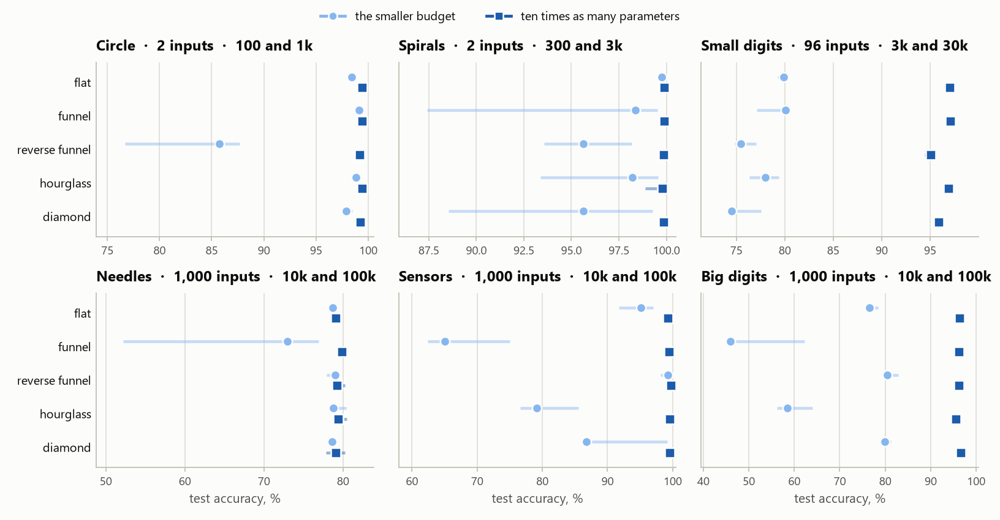

*Light circles: the smaller budget. Dark squares: ten times as many parameters. Horizontal bars show the lowest and highest seed. Note that each panel has its own scale.*

**With enough parameters, shape hardly matters.** At the bigger budget the five shapes were within about 2 points of each other on every task, and within about 1 point on five of the six. The largest gap was on the small digits, where the two shapes that start narrow (reverse funnel 95.1%, diamond 95.9%) trailed the ones that start wide (flat 97.0%, funnel 97.1%), which fits the first-layer result above.

**When parameters are short, the damage comes from a pinch.** At 10,000 parameters on a 1,000-input task every shape is forced to have a first layer of 9 or 10 units, so the shapes differ only in what comes after. The two that squeeze down to 2 units fall apart:

| At about 10,000 parameters | Sensors | Big digits |
|---|---|---|
| reverse funnel, 9-18-36 | 99.3% | 80.4% |
| diamond, 9-36-9 | 86.7% | 79.9% |
| flat, 10-10-10 | 95.2% | 76.6% |
| hourglass, 10-2-10 | 79.2% | 58.5% |
| funnel, 10-5-2 | 65.0% | 46.0% |

A funnel is a sensible shape when it has room. It becomes a bad one exactly when its last layer gets down to a couple of units.

### Does a bigger network overfit?

The usual worry is that a network with far more parameters than training examples will memorise the examples and do badly on new ones. Here are training and test accuracy side by side for three-layer networks.

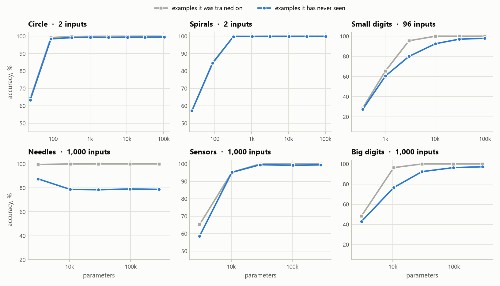

On the two digit tasks the networks do memorise: training accuracy is 100% from 10,000 parameters up on the small digits and from 30,000 up on the big ones. But test accuracy keeps rising anyway, and the gap between the two gets smaller as the network grows, not larger. On the small digits the gap was 15.5 points at 3,000 parameters, 7.5 at 10,000 and 2.1 at 100,000. The worst place to be was the middle: big enough to memorise, too small to do it gracefully.

The needles are the exception, and a clear one. Every three-layer network from 10,000 parameters up fitted its 10,000 training examples perfectly and scored 78 to 79% on new ones. A model with no hidden layer scored 87.5%, and so did the smallest networks. No bigger equal-width network got back to that level, although the largest single-layer one (80.5% at 305,000 parameters) was a little better than the mid-sized ones (78.2% at 29,000). On this task the limit is data, not capacity: 990 of the inputs are noise, 10,000 examples are not enough to tell which, and every extra weight on those inputs is another way to fit noise.

So the answer here was: bigger is safe when the task rewards capacity, and harmful when there are many useless inputs and too few examples to rule them out. With weight decay or early stopping the needles result might well change; none was used.

### Activation functions

The size sweep was repeated with Leaky ReLU (slope 0.01 below zero), GELU and tanh, at 3 and at 8 hidden layers, up to 100,000 parameters.

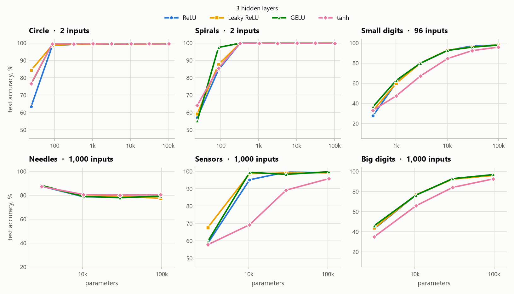

| 3 hidden layers | Spirals, 100 parameters | Small digits, 100k | Sensors, 30k | Big digits, 100k |
|---|---|---|---|---|
| ReLU | 84.6% | 97.9% | 99.5% | 96.3% |
| Leaky ReLU | 87.6% | 97.9% | 99.0% | 96.0% |
| GELU | 97.4% | 97.9% | 98.3% | 96.8% |
| tanh | 85.5% | 95.9% | 89.2% | 92.5% |

- **ReLU, Leaky ReLU and GELU are close.** From 1,000 parameters up they were within 2 points of each other in most cases, with no consistent winner. The gaps that were bigger (up to about 4 points) were all in networks only just large enough for their task, for example the sensors at 10,000 parameters: 95.2% with ReLU, 98.7% with Leaky ReLU, 99.4% with GELU.
- **GELU helps most when the network is tiny.** At 100 parameters on the spirals it scored 97.4% against 84.6% for ReLU. A smooth curve gets more out of five units than a hard corner does.
- **tanh was behind on the digits and the sensors:** 2 points on the small digits and about 4 on the big digits at 100,000 parameters, and 10 on the sensors at 30,000 (4 at 100,000). The gap was wider in smaller networks. On the two-input tasks and the needles it matched the others.

At 8 hidden layers the picture is the same with one addition: the smallest ReLU networks collapse where the others do not.

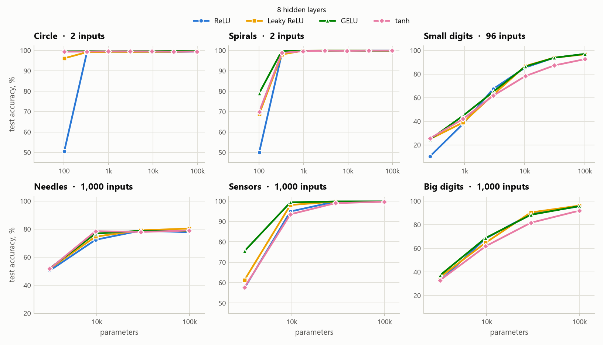

With 8 layers of 3 units (about 100 parameters), ReLU scored 50.5% on the circle, which is chance. Leaky ReLU scored 96.1%, tanh 99.4% and GELU 99.6% with the same shape.

### Networks that die

A ReLU unit outputs zero whenever its input is negative, and passes no learning signal back while it does. If a unit gets pushed to where its input is negative for every example, it never recovers. In a thin layer it only takes a few such units to cut the network in two, and from then on it gives the same answer to everything.

That happened here. Counting a run as collapsed when it ended at chance level although the same network scored at least 15 points above chance on another run:

| Hidden layers | 1 | 2 | 3 | 5 | 8 | 12 |
|---|---|---|---|---|---|---|
| ReLU: collapsed runs, of the three reported per network | 0 of 99 | 0 of 111 | 11 of 975 | 3 of 102 | 8 of 105 | 7 of 90 |

Of the 31 collapsed runs among the 2,094 reported, 29 were ReLU networks (the other two were one Leaky ReLU and one GELU network), and 26 were in networks with a layer of 3 units or fewer. But not all: an 8-layer network of 64 units and a 12-layer network of 29 units each lost one seed of three on the circle, at a learning rate that had worked well on the first seed. That is why the charts show the range across seeds and not only the middle.

The risk goes up with depth, with thin layers and with the learning rate. Over all 3,965 runs, including learning rates that were tried and rejected, 149 collapsed.

### The learning rate

This project is about size, but the learning rate would not stay out of it.

- **It mattered as much as the shape.** For the median network, the best and worst learning rates tried on seed 0 were 4.8 points of test accuracy apart, and for half the networks more than 5 points. Comparing shapes at a single fixed learning rate would have given different answers.
- **Small networks want a high rate.** The rate that won most often was 0.01 for both size groups, but below 30,000 parameters a third of the networks did best at 0.03 or 0.1, and above it only a tenth did.

| Winning learning rate | 0.0003 | 0.001 | 0.003 | 0.01 | 0.03 | 0.1 |
|---|---|---|---|---|---|---|
| Networks under 30,000 parameters | 2 | 22 | 86 | 213 | 144 | 19 |
| Networks of 30,000 parameters or more | 5 | 33 | 56 | 96 | 21 | 1 |

- **Three rates were not enough.** In the first full run, each network got three learning rates and for 62% of them the best was the highest or the lowest of the three. The search now carries on past either end until the best rate is in the middle, and 429 of the 698 networks were extended that way. It turned out to change little: 3% of the networks moved by more than a point, mostly tiny or pinched ones, and none of the conclusions changed.

### What it costs

Timed separately from the experiments (`bench.py`): ordinary PyTorch, one network at a time, one CPU core.

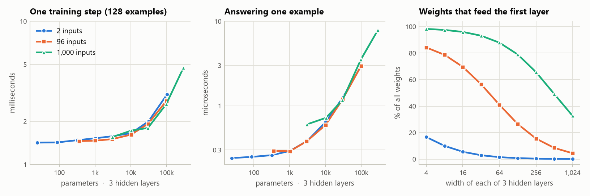

| 3 hidden layers, 2 inputs | 87 parameters | 1,031 | 10,292 | 31,121 | 102,827 |
|---|---|---|---|---|---|
| One training step (128 examples) | 1.43 ms | 1.52 ms | 1.66 ms | 2.00 ms | 3.09 ms |
| Answering one example | 0.25 µs | 0.29 µs | 0.65 µs | 1.26 µs | 3.03 µs |

**Below about 10,000 parameters, size is nearly free and depth is not.** A training step on a small network is almost all bookkeeping: about a quarter of a millisecond per layer whatever the width. So 100 times more parameters (87 to 10,292) cost 16% more time, while going from 3 layers to 12 at the same 1,000 parameters cost two and a half times as much (1.52 ms to 3.77 ms).

**Above that, time follows the parameter count.** Tripling the parameters from 31,000 to 103,000 multiplied the time to answer an example by 2.4, and the number of inputs made little difference to the time once the parameter count was the same.

**One enormous layer is the exception.** A layer of 20,347 units on 2 inputs has 101,737 parameters, about the same as three layers of 225. It took 12.9 ms per training step against 3.2 ms, and 32.9 µs per example against 3.0 µs. Parameters count the weights, but every unit's output also has to be computed, stored and passed back, for every example in the batch, and a layer that is wide but connected to only 2 inputs and 2 outputs has a great many units per weight. (This is why shapes with a layer wider than 4,096 units were left out of the experiments.)

## What this does not show

- **These are small synthetic tasks and plain fully-connected networks.** Nothing here says anything about convolutional networks or transformers, or about real images, where the layout of the pixels can be built into the network.
- **Every network on a task got the same number of training steps.** A small network could have run many more steps in the time a big one takes. Nor was there any weight decay, dropout or early stopping, any of which might change the overfitting results, the needles most of all.
- **Three seeds per network.** The range across seeds is shown wherever it is a point or more. Differences of under a point between two networks should not be read as real, and the learning rate was chosen on one seed.
- **Nothing bigger than 550,000 parameters was trained,** and each task has one training-set size. How much data there is changes how big a network is worth having, and that was not explored.
- **The sensors task depends on a scaling choice.** Its 1,000 readings are scaled down so that the whole input is about as long as the two-number input of the plain spiral task. With every reading at full size the same networks trained erratically in a pilot (run without sensor noise): a 64-64-64 network scored 63%, 77%, 99.9% and 51% at four learning rates, against 99.9% or better at all three rates tried after scaling. The likely reason is that Adam moves every weight by about the same small amount per step, and when 1,000 inputs all carry the same signal, 1,000 small moves add up to a large jump in what a unit computes.
- **The timings are for one CPU core.** On a GPU, wide layers are cheap compared with deep ones, and the balance between them would be different.

## Run it yourself

It needs Python 3.10 or newer and runs on a CPU.

```
pip install -r requirements.txt
python run.py          # every experiment: about an hour and a half on four cores, safe to stop and restart
python bench.py        # the timing measurements: a minute or two, best on an idle computer
python report.py       # figures into results/figures, tables into RESULTS.md
python -m pytest       # the checks
```

`python run.py --list` shows what would run and roughly how long it takes. `python run.py --only dial` runs one experiment (`grid`, `first_budget`, `sweeps`, `shapes`, `activations` or `dial`), and `--only digits1000` runs everything whose name contains that text. For a miniature of the whole thing in a few minutes:

```
python run.py --steps 0.1 --seeds 0 --out trial
python report.py --out trial
```

To try your own shape, call the plain trainer directly. It returns a dictionary with the accuracies, the parameter count and the learning curve:

```python
from netsize.train import train
result = train("digits1000", widths=[256, 32, 32], activation="relu", lr=0.003, seed=0)
print(result["params"], result["test_acc"])
```

The task names are `circle`, `spirals`, `digits96`, `needle`, `sensors` and `digits1000`; `spirals@5` is the spiral task with 5 turns. To add a task, write a function that returns inputs and class numbers and add a line to the list in `netsize/tasks.py`. To add an experiment, add a function to `netsize/experiments.py` that returns the networks it wants.

## What is in the repository

| Path | What it is |
|---|---|
| `netsize/tasks.py` | The six tasks, generated from scratch |
| `netsize/nets.py` | The network, the parameter counting, and the code that turns "this many parameters in this shape" into layer widths |
| `netsize/train.py` | Training one network with ordinary PyTorch: the readable version |
| `netsize/fast.py` | The trainer the experiments use: several same-shaped networks side by side, with the backward pass and Adam written out by hand. It computes the same thing as `train.py` to within rounding (the tests check this) and is several times faster on small networks |
| `netsize/experiments.py` | The list of every network in every experiment, and the learning-rate search |
| `netsize/store.py` | Reading and writing the saved runs |
| `netsize/clock.py` | A CPU-time clock that is fine-grained on Windows |
| `run.py` | Runs the experiments on all cores, saves every run, skips what is already done |
| `bench.py` | Times training steps and forward passes |
| `report.py` | Draws the figures and writes `RESULTS.md` |
| `results/runs/` | Every training run as one line of JSON: accuracies, losses, learning curve, dead units, and for the two-input tasks the decision map |
| `results/cost.csv` | The timing measurements |
| `results/figures/` | The figures on this page |
| `RESULTS.md` | Every number, as tables |
| `tests/` | Checks on the counting, the shapes, the tasks and the two trainers agreeing |

## Licence

MIT. See [LICENSE](LICENSE).
